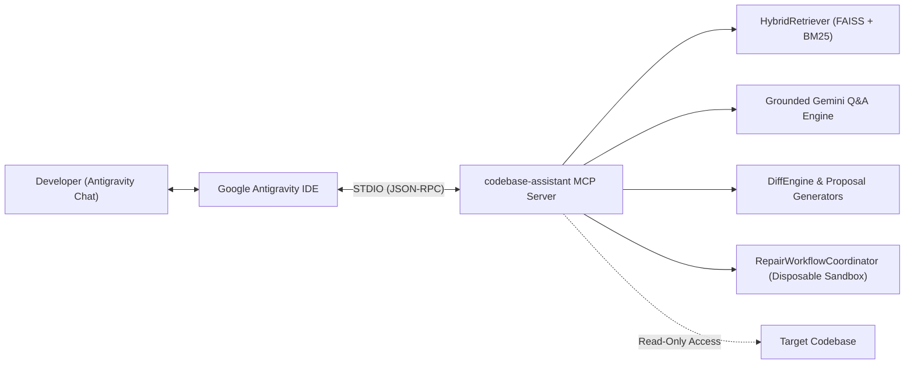

# Codebase Assistant — RAG-Powered Coding Agent

`codebase-assistant` is an autonomous, RAG-powered coding assistant and agentic repair system designed to inspect software repositories, index AST symbols and documentation, perform hybrid semantic/keyword search, answer technical architecture questions with strict citations, generate AST-verified code and test proposals (as unified diffs), and orchestrate autonomous, bounded repair workflows with sandboxed test execution.

---

## 🏗️ Architecture Blueprint

The diagram below illustrates the end-to-end architecture across all seven development phases, highlighting the clear separation between ingestion, grounded retrieval, autonomous tool orchestration, sandboxed repair, and offline quality evaluation:

```mermaid
flowchart TD
    %% FLOW 1: Indexing Flow
    subgraph Flow1["1. Repository Ingestion & Indexing (Phases 1 & 2)"]
        Repo["Target Codebase\n(Read-Only Knowledge Source)"] --> Scanner["Repository Scanner\n(Path filters, pruning, secret exclusion)"]
        Scanner --> Parser["AST & Structure Parser\n(Classes, methods, functions, docs)"]
        Parser --> Chunker["Logical Chunker\n(Scope preservation, line bounds, chunk IDs)"]
        Chunker --> Indexer["Incremental Indexer\n(SHA-256 change detection, stale eviction)"]
        Indexer --> LocalIndex[("Local Knowledge Base\n(.codebase_assistant/ manifest + chunks)")]
        Chunker -.-> EmbedModel["Embedding Provider\n(Gemini text-embedding-004 / Mock)"]
        EmbedModel -.-> VectorIndex[("Vector Store\n(.codebase_assistant/ cosine index)")]
    end

    %% FLOW 2: Runtime Retrieval & Q&A
    subgraph Flow2["2. Grounded Retrieval & Q&A (Phase 3)"]
        UserQ(["Developer Query / Task"]) --> Retriever["Hybrid Retriever\n(Cosine Vector Similarity + Okapi BM25 / RRF)"]
        LocalIndex --> Retriever
        VectorIndex --> Retriever
        Retriever --> ContextAssembler["Context Assembler\n(Token budget limiter & deduplication)"]
        ContextAssembler --> PromptBuilder["Prompt Builder\n(Strict grounding, injection barrier)"]
        PromptBuilder --> LLMClient["Gemini Client\n(gemini-2.5-pro / gemini-2.5-flash / Mock)"]
        LLMClient --> Answer(["Grounded Answer with Citations"])
    end

    %% FLOW 3: Proposals & Patch Verification
    subgraph Flow3["3. Proposal Generation & Diff Engine (Phase 5)"]
        PromptBuilder --> CodeGen["CodeProposalGenerator\n(Context-aware unified diff generation)"]
        PromptBuilder --> TestGen["TestProposalGenerator\n(Framework auto-detection, targeted test suite)"]
        CodeGen --> DiffEngine["Deterministic Diff Engine\n(In-memory patch dry-run, AST syntax check)"]
        TestGen --> DiffEngine
        DiffEngine --> VerifiedProposal(["Verified Unified Diff Proposal"])
    end

    %% FLOW 4: Agent Orchestration & Sandboxing
    subgraph Flow4["4. Agent Orchestration & Security Policy (Phase 6)"]
        AgentCore["AgentCoordinator (ReAct Loop)\n(Step, token budget & iteration bounds)"]
        AgentCore --> ToolReg["Tool Registry\n(READ_ONLY, PROPOSAL, CONSEQUENTIAL)"]
        ToolReg --> PolicyCheck{"PolicyEngine\n(Command whitelist & path boundary)"}
        PolicyCheck -->|Policy Denied| Abort["Immediate Rejection"]
        PolicyCheck -->|Policy Passed| PermCheck{"PermissionEngine\n(Consequential Action?)"}
        PermCheck -->|Read-only / Proposal| AutoExec["Automatic Execution"]
        PermCheck -->|Consequential| AuthCheck{"User Authorization\n(Interactive prompt / --auto-approve)"}
        AuthCheck -->|Denied| StopAgent["Clean Termination"]
        AuthCheck -->|Approved| ExecTool["Execute Tool"]
    end

    %% FLOW 5: Agentic Repair Workflows
    subgraph Flow5["5. Agentic Repair & Sandboxed Verification (Phase 7)"]
        RepairCoord["RepairWorkflowCoordinator\n(Cumulative budget, timeout & retry tracking)"]
        RepairCoord --> PlanStep["Task Planning & Context Retrieval"]
        PlanStep --> ProposeStep["Diff Proposal & AST Verification"]
        ProposeStep --> SandboxExec["Disposable Sandbox Workspace\n(tempfile workspace, proxy blocking, 30s timeout)"]
        SandboxExec --> TestRun{"Sandboxed Test Execution\n(pytest / python -m unittest)"}
        TestRun -->|Tests Pass| SuccessState["SUCCESS\n(Report generated, changes verified)"]
        TestRun -->|Tests Fail| DiagEngine["DiagnosticEngine\n(Stack trace parsing, prompt sanitization)"]
        DiagEngine --> RetryCheck{"Retries < Max?\n(Bounded self-repair)"}
        RetryCheck -->|Yes| ProposeStep
        RetryCheck -->|Exhausted| Rollback["Atomic Rollback\n(Restore backups, unlink new files)"]
        Rollback --> FailState["MAX_RETRIES_EXCEEDED / ROLLBACK_FAILED"]
    end

    %% FLOW 6: Offline Evaluation Flow
    subgraph Flow6["6. Offline Benchmark & Quality Gates (Phase 4)"]
        GoldenData[("Golden Dataset\n(data/golden_dataset.json - 25 cases)")] --> EvalRunner["EvaluationRunner\n(Deterministic offline benchmark)"]
        EvalRunner --> QualityGates{"Quality Gate Policy\n(Hard gates & provisional baselines)"}
        QualityGates --> EvalReport["Reports & Artifacts\n(reports/eval_report.json + Markdown)"]
    end
```



---

## 📋 Features by Phase

| Phase | Capability | Core Modules |
| :--- | :--- | :--- |
| **Phase 1** | **Repository Ingestion & AST Parsing** | `RepositoryScanner`, `CodeParser`, `LogicalChunker`, `IncrementalIndexer` |
| **Phase 2** | **Incremental Indexing & Local Caching** | SHA-256 change detection, repo identity check, stale chunk eviction |
| **Phase 3** | **Embeddings, Hybrid Retrieval & Grounded Q&A** | `GeminiEmbeddingProvider`, `VectorStore`, `CodeTokenizer`, `BM25Retriever`, `HybridRetriever`, `CodebaseQAEngine` |
| **Phase 4** | **Golden Dataset & Quality Gate Evaluation** | 25-case golden benchmark, chunk/file metrics, citation line checking, abstention matrix, injection defense |
| **Phase 5** | **Code & Test Proposals with Diff Engine** | `DiffEngine` (in-memory dry-run, AST syntax check), `CodeProposalGenerator`, `TestProposalGenerator` |
| **Phase 6** | **Controlled Tools & Execution Sandbox** | `AgentCoordinator` (ReAct loop), `PolicyEngine`, `PermissionEngine`, `ToolRegistry` |
| **Phase 7** | **Agentic Repair Workflows** | `RepairWorkflowCoordinator`, disposable sandbox copy, `DiagnosticEngine`, multi-file backup/atomic rollback |
| **Phase 8** | **Release Hardening, CI/CD & Final Handover** | Matrix CI workflow, Black/isort/mypy compliance, read-only cryptographic guarantees, packaging |

---

## 🛠️ Installation & Setup

### Prerequisites
- Python 3.10, 3.11, 3.12, or 3.13
- Git

### 1. Editable Installation
Clone the repository and install with all optional dependencies:
```bash
git clone https://github.com/phaniranjan/codebase_assistant.git
cd codebase_assistant

# Install with AI (Gemini/FAISS), dev (pytest/mypy/black), and eval dependencies:
pip install -e ".[ai,dev,eval]"
```

Verify that the CLI is installed and responsive:
```bash
codebase-assistant --help
```

### 2. Environment Configuration
Copy the example `.env` file:
```bash
cp .env.example .env
```

Key environment configuration variables:
```ini
# Gemini API Key (required for live Gemini operations; not required for mock/offline mode)
GEMINI_API_KEY=your_gemini_api_key_here

# Model Selection
GEMINI_MODEL=gemini-2.5-flash
GEMINI_EMBEDDING_MODEL=text-embedding-004

# Cache & Storage
CODEBASE_CACHE_DIR=.codebase_assistant

# Agent Bounds & Safety
MAX_TOOL_CALLS_PER_TURN=5
MAX_REASONING_STEPS=10
COMMAND_TIMEOUT_SECONDS=30.0
CONTEXT_TOKEN_BUDGET=8192
```

---

## 💻 Complete CLI Reference

All CLI commands accept the target repository either as a positional argument (`[REPO_PATH]`) or via `--repo-path` (defaulting to the current working directory `.`).

Commands fail fast by default: when live Gemini operations fail due to quota or missing keys, they exit with code 1 instead of silently falling back to mock mode, unless `--allow-fallback` is explicitly provided.

### 1. `scan`
Scan a repository and display detected files, revisions, and excluded secrets:
```bash
codebase-assistant scan /path/to/repository
```

### 2. `index`
Build or incrementally update the local AST symbol index:
```bash
codebase-assistant index /path/to/repository

# Force full rebuild of the index:
codebase-assistant index /path/to/repository --rebuild

# Custom cache directory:
codebase-assistant index /path/to/repository --cache-dir /external/cache/dir
```

### 3. `inspect-chunks`
Inspect extracted chunks, AST symbol names, line boundaries, and metadata:
```bash
# Inspect chunks for a specific source file:
codebase-assistant inspect-chunks /path/to/repository --file src/pipeline.py --limit 10

# Filter by symbol name:
codebase-assistant inspect-chunks /path/to/repository --symbol BM25Retriever
```

### 4. `embed`
Generate and synchronize vector embeddings for all indexed chunks:
```bash
# Using live Gemini embeddings (requires GEMINI_API_KEY):
codebase-assistant embed /path/to/repository --provider gemini

# Offline execution using deterministic mock embeddings (zero API keys):
codebase-assistant embed /path/to/repository --provider mock
```

### 5. `search`
Retrieve relevant code chunks using dense vector similarity, sparse BM25, or hybrid Reciprocal Rank Fusion:
```bash
# Hybrid search (default):
codebase-assistant search "BM25 score calculation" /path/to/repository --mode hybrid --top-k 5

# Dense-only or sparse-only search:
codebase-assistant search "class CodebaseQAEngine" /path/to/repository --mode sparse_only
```

### 6. `ask`
Ask questions grounded strictly in the target repository code with verified citations:
```bash
# Live grounded Q&A with Gemini:
codebase-assistant ask "How does the indexer detect modified files?" /path/to/repository

# Streaming response with real-time token output:
codebase-assistant ask "Explain the hybrid retrieval fusion formula" /path/to/repository --stream

# Completely offline using mock provider:
codebase-assistant ask "What is the token budget limit?" /path/to/repository --provider mock
```

### 7. `evaluate`
Execute reproducible offline or live evaluation benchmarks against the golden dataset:
```bash
# Offline benchmark with quality gates enforced (exits code 1 on failure):
codebase-assistant evaluate /path/to/repository --dataset data/golden_dataset.json --fail-under

# Compare all retrieval modes (hybrid, dense_only, sparse_only):
codebase-assistant evaluate /path/to/repository --mode all

# Explicit live evaluation with Gemini:
codebase-assistant evaluate /path/to/repository --live
```

### 8. `propose-code`
Generate context-aware unified diff modifications with pre-flight AST validation:
```bash
# Propose a code modification:
codebase-assistant propose-code "Add exponential backoff retry" /path/to/repository --file src/pipeline.py

# Save proposed patch to an external patch file (never inside the target repository):
codebase-assistant propose-code "Add logging" /path/to/repository --file src/pipeline.py --output-patch /tmp/patch.diff
```

### 9. `propose-tests`
Generate targeted unit tests with automatic framework detection (`pytest` vs `unittest`):
```bash
codebase-assistant propose-tests src/pipeline.py /path/to/repository
```

### 10. `agent`
Execute autonomous ReAct agent loop with controlled tools and interactive authorization:
```bash
# Interactive mode (prompts before running tests or modifying files):
codebase-assistant agent "Locate calculator implementation and verify tests" /path/to/repository

# Automated mode with pre-approved consequential actions (for disposable CI):
codebase-assistant agent "Analyze dependency vulnerabilities" /path/to/repository --auto-approve

# Offline agent execution:
codebase-assistant agent "Inspect scanner module" /path/to/repository --provider mock --auto-approve
```

### 11. `repair`
Orchestrate an end-to-end autonomous repair workflow (plan, propose, patch in memory, run sandboxed tests, diagnose failures, bounded self-repair, atomic rollback):
```bash
# Autonomous repair with automated verification:
codebase-assistant repair --task "Fix ZeroDivisionError in calculate_average" --target-file src/calc.py --test-command "pytest tests/test_calc.py" /path/to/repository --auto-approve

# Output JSON report:
codebase-assistant repair --task "Refactor cache sync" /path/to/repository --json

# Save Markdown audit report to external file:
codebase-assistant repair --task "Fix timeout bug" /path/to/repository --report-file reports/repair_audit.md
```

---

## 🔒 Security Model & Sandbox Architecture

The security model is defined strictly around the principle that **target codebases are untrusted and read-only knowledge sources**:

### 1. Tool Permission Hierarchy
- **`READ_ONLY`** (`search_codebase`, `read_source_file`, `find_related_tests`, `inspect_dependencies`): Scoped strictly within the repository workspace. External symlinks are outright rejected.
- **`PROPOSAL`** (`generate_code_proposal`, `generate_test_proposal`): Synthesizes changes entirely in memory as standard unified diffs. Pre-flight parses code with `ast.parse()`. No disk writes.
- **`CONSEQUENTIAL`** (`run_selected_tests`, `apply_patch`): Requires explicit interactive confirmation from the user (unless running with `--auto-approve` in a disposable CI environment).

### 2. Disposable Execution Workspace & Network Isolation
When running test suites during repair workflows:
1. **Disposable Working Copy**: Tests are executed in an isolated temporary directory (`tempfile.TemporaryDirectory`). The target source checkout is never directly touched by test runners.
2. **Command Whitelist**: `PolicyEngine` strictly permits only `pytest` and `python -m unittest` / `python3 -m unittest`. Shell metacharacters (`&&`, `;`, `|`, `>`, `$()`) are blocked.
3. **Loopback Proxy Redirection**: The execution subprocess environment sets `HTTP_PROXY`, `HTTPS_PROXY`, and `ALL_PROXY` to `http://127.0.0.1:0` with `NO_PROXY=""`, redirecting external network access to a dead loopback port.
4. **Execution Timeout**: Commands enforce a hard 30-second timeout per execution.

### 3. Patch Application Atomicity & Exact Rollback
Before applying any multi-file diff:
- Original file contents are backed up in memory.
- Newly created files are tracked.
- If patch application or syntax validation fails, modified files are restored and new files are unlinked.
- If restoration fails, `ROLLBACK_FAILED` is explicitly reported with the list of affected paths.

### 4. Untrusted Diagnostic Sanitization
Stack traces and test outputs can contain adversarial prompts. `sanitize_untrusted_text()` scrubs system delimiters (e.g. `[SYSTEM INSTRUCTIONS]`) and caps traceback lengths before passing them to the LLM for diagnosis.

### 5. Read-Only Target Invariant
The target repository (e.g., `ai-evaluation`) is cryptographically verified to be immutable. All index caches (`.codebase_assistant/`), evaluation reports (`reports/`), and patches must be written to external directories.

---

## 🔧 Troubleshooting & FAQ

### Gemini API Quotas & Credentials
- **Issue**: `google.genai.errors.APIError: 429 Quota Exceeded` or missing key.
- **Resolution**: Verify that `GEMINI_API_KEY` is set in your environment or `.env` file. If running in CI or offline testing, use `--provider mock` or evaluate without `--live` for deterministic, zero-network execution.

### Offline & Mock Execution
- Every core command (`embed`, `search`, `ask`, `propose-code`, `propose-tests`, `agent`, `repair`, `evaluate`) supports `--provider mock` (or offline default in `evaluate`). Mock execution produces reproducible results without external API access.

### Cache Management & Stale Eviction
- If repository files have been reorganized or if you want to regenerate the index from scratch, run:
  ```bash
  codebase-assistant index /path/to/repository --rebuild
  ```
- To specify an external cache directory outside the target repository:
  ```bash
  codebase-assistant index /path/to/repository --cache-dir /tmp/my_cache
  ```

### Windows & WSL Path Handling
- Paths are normalized across Windows (`\`) and Unix (`/`) using `normalize_rel_path()`.
- When referencing UNC or WSL paths (e.g., `\\wsl.localhost\...`), forward slashes or standard UNC format can be used interchangeably.
- Test paths and target files are resolved and verified against the repository boundary to prevent path traversal attacks.

---

## 🧪 Testing & CI/CD

### Running Tests Locally
```bash
# Run full unit test suite:
pytest tests/unit -v --tb=short

# Run adversarial security test suite:
pytest tests/unit/test_repair_adversarial.py -v

# Run format and lint checks:
black --check src tests
isort --check-only src tests
mypy src

# Run golden dataset quality evaluation:
codebase-assistant evaluate ../ai-evaluation --dataset data/golden_dataset.json --fail-under
```

### GitHub Actions CI
The CI workflow (`.github/workflows/ci.yml`) executes on every push and pull request across Python **3.10, 3.11, 3.12, and 3.13**, verifying formatting, typing, unit tests, adversarial security tests, and RAG quality gates on every commit.

---

## 🔌 Using codebase-assistant from Google Antigravity

`codebase-assistant` v0.2.0 features native integration with Google Antigravity IDE using the **Model Context Protocol (MCP)**. This enables natural-language conversational pair programming directly inside Antigravity without needing to remember CLI commands, flags, or internal tool names.

### 1. Integration Architecture



- **Conversational Interface**: Antigravity acts as the conversational client, parsing developer intent and selecting appropriate tools.
- **Intelligence & Execution Backend**: `codebase-assistant` runs as a local subprocess over standard input/output (STDIO), executing indexing, hybrid search, AST validation, and sandboxed test-driven repair.
- **Clean Transport Isolation**: All JSON-RPC protocol messages flow over `stdin`/`stdout`, while application diagnostic logs route strictly to `stderr`.

---

### 2. Antigravity MCP Configuration (`mcp_config.json`)

To register `codebase-assistant` with Antigravity, add it to your global configuration file (`~/.gemini/config/mcp_config.json`) or workspace configuration:

#### Windows Configuration
```json
{
  "mcpServers": {
    "codebase-assistant": {
      "command": "python",
      "args": [
        "-m",
        "codebase_assistant.mcp_server"
      ],
      "env": {
        "GEMINI_API_KEY": "${GEMINI_API_KEY}"
      }
    }
  }
}
```

#### Linux / WSL Configuration
```json
{
  "mcpServers": {
    "codebase-assistant": {
      "command": "/home/username/codebase_assistant_venv/bin/python",
      "args": [
        "-m",
        "codebase_assistant.mcp_server"
      ],
      "env": {
        "GEMINI_API_KEY": "${GEMINI_API_KEY}"
      }
    }
  }
}
```

> [!TIP]
> Alternatively, you can run `codebase-assistant mcp` or `codebase-assistant-mcp` as the executable command.

---

### 3. Antigravity Skill Installation

The assistant bundles an Antigravity skill located at:
```
.agents/skills/codebase-assistant/SKILL.md
```
Antigravity automatically discovers skills placed in `.agents/skills/` within your workspace, allowing the conversational agent to understand when to invoke search, Q&A, proposal generation, or self-repair based on your prompts.

---

### 4. Natural-Language Conversational Examples

Once connected, you can talk to the agent naturally:

| User Request | What Antigravity Executes |
| :--- | :--- |
| *"Select the `/path/to/my-repo` repository for analysis."* | Calls `set_active_repository`, indexes files, and synchronizes embeddings. |
| *"What components make up the authentication architecture?"* | Calls `ask_codebase` to provide a grounded response with verified file citations. |
| *"Where is the retry backoff algorithm implemented?"* | Calls `search_codebase` using hybrid vector + BM25 ranking and presents code snippets. |
| *"Add exponential backoff with jitter to the API client."* | Calls `propose_code`, generates an AST-validated unified diff, and presents the reasoning. |
| *"Generate unit tests for `src/auth.py` covering token expiration."* | Calls `propose_tests` with automatic framework detection (`pytest` vs `unittest`). |
| *"Investigate why users get a 403 when updating their profiles."* | Calls `investigate_task` to run an autonomous multi-step ReAct investigation loop. |
| *"Run the test suite, diagnose any failures, and fix the code."* | Calls `repair_code` in an isolated disposable sandbox with network proxy isolation. |
| *"Apply the proposed patch to my development checkout."* | Prompts for human approval checkpoint before executing `apply_approved_patch`. |

---

### 5. Security & Human Approval Model

- **Read-Only Invariant**: Target codebases are strictly read-only knowledge sources by default.
- **Explicit Writable Workspace**: Changes can only be written to explicitly designated writable checkouts (`writable=True` or `target_workspace`).
- **Human Approval Checkpoint**: `apply_approved_patch` is a consequential tool requiring confirmation (`confirmation='CONFIRM_APPLY'`); model-generated approval flags cannot bypass human confirmation.
- **Atomic Rollback**: If a write fails during multi-file patch application, modified files are restored and newly created files are unlinked. Rollback errors surface explicitly with status `ROLLBACK_FAILED`.
- **Untrusted Diagnostic Defanging**: Repository code, logs, and stack traces are treated as untrusted data and defanged with `sanitize_untrusted_text()`.

---

### 6. Troubleshooting Antigravity MCP Integration

- **MCP Protocol Errors / JSON Parsing Failures**:
  - Verify that standard logging goes to `stderr`. Never use `print()` statements on `stdout` in server code or imported utilities.
- **Tool Timeout on First Run**:
  - Initial repository indexing can take several seconds for large repositories. In your MCP client configuration, set timeouts to `120s` or higher.
- **Missing API Key / Offline Mode**:
  - If `GEMINI_API_KEY` is not exported, `codebase-assistant` automatically runs in offline mock mode using deterministic local hash embeddings.
- **Path Resolution across Windows / WSL**:
  - Always pass absolute or workspace-relative paths. Windows UNC paths (`\\wsl.localhost\Ubuntu\...`) and Unix paths (`/home/...`) are automatically normalized.
