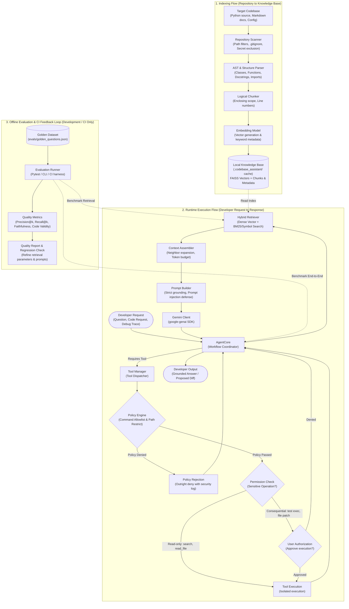

# Codebase Assistant — RAG-Powered Coding Agent

`codebase-assistant` is an AI-powered coding assistant that ingests an existing software repository, understands its architecture, tracks AST symbols, retrieves relevant source code via hybrid search, and coordinates with Gemini to answer questions, generate context-aware code proposals (as unified diffs), generate tests, and assist with debugging.

---

## 🏗️ Architecture Blueprint



---

## 🚀 Key Capabilities (Milestone 1)

1. **AST-Aware Code Extraction**: Uses Python's native `ast` engine to extract classes, member methods, standalone functions, module imports, and docstrings.
2. **Logical Chunking**: Never blindly splits files at arbitrary character boundaries. Preserves enclosing class headers, decorators, parameters, and precise `start_line` / `end_line` ranges.
3. **Strict Secret Exclusion**: Automatically identifies and rejects `.env`, `.env.*`, `*.pem`, `*.key`, `id_rsa`, `credentials.json`, `token.json`, and secret patterns.
4. **Source Revision Tracking**: Directly reads Git commit SHAs and branch references from `.git`, storing the commit SHA in chunk metadata for stale context detection.
5. **Incremental Indexing**: SHA-256 change detection re-chunks only added or modified files, reuses unchanged chunks, and purges stale chunks when files are deleted.
6. **Zero API Key Required for Ingestion & Tests**: Scanner, parser, chunker, and incremental indexer run completely offline without external network or LLM dependencies.

---

## 🛠️ Setup & Installation

### Prerequisites
- Python 3.10+ (tested through Python 3.13)
- Optional: Google Gemini API key (`GEMINI_API_KEY`) for runtime Q&A and embeddings.

### 1. Installation
Install in editable mode:
```bash
pip install -e .
```

To include development and evaluation dependencies:
```bash
pip install -e ".[dev,eval]"
```

### 2. Configuration (`.env`)
Copy the example environment configuration:
```bash
cp .env.example .env
```
Key settings available in `.env`:
- `GEMINI_API_KEY`: API key for Gemini LLM generation and embeddings.
- `GEMINI_MODEL`: Default generative model (default: `gemini-2.5-flash`).
- `GEMINI_EMBEDDING_MODEL`: Embedding model (default: `gemini-embedding-001`).
- `CODEBASE_CACHE_DIR`: Directory where index manifests and chunks are stored (default: `.codebase_assistant`).
- `MAX_TOOL_CALLS_PER_TURN`: Maximum tool iterations to prevent infinite loops (default: 5).
- `COMMAND_TIMEOUT_SECONDS`: Strict timeout for authorized command execution (default: 30s).

---

## 💻 CLI Usage

### 1. Scan a Repository
Scan a local repository to inspect eligible files, excluded files, and git revision without modifying the target:
```bash
python -m codebase_assistant.cli scan /path/to/repository
```
Example output:
```
Scanning repository: /home/user/ai-evaluation
Source Revision: 69fdf14e (branch: main)
Eligible Files: 62
Excluded Files / Rules: 203
```

### 2. Index a Repository
Perform an incremental index of the repository:
```bash
python -m codebase_assistant.cli index /path/to/repository
```

To force a full rebuild:
```bash
python -m codebase_assistant.cli index /path/to/repository --rebuild
```

Custom cache directory:
```bash
python -m codebase_assistant.cli index /path/to/repository --cache-dir .codebase_assistant/custom_index
```

### 3. Inspect Stored Chunks
Inspect extracted AST symbols and metadata:
```bash
python -m codebase_assistant.cli inspect-chunks --file rag_pipeline.py --limit 10
```
Filter by symbol name:
```bash
python -m codebase_assistant.cli inspect-chunks --symbol BM25Retriever
```

---

## 🧪 Running Tests

Run the full unit and integration test suite:
```bash
python -m unittest discover -s tests -v
```
Or with pytest:
```bash
pytest tests/ -v
```

All 20 tests execute in ~3 seconds completely offline, including live read-only verification against `ai-evaluation`.

---

## 🔒 Security & Privacy

1. **Read-Only Target Repository**: Target repositories are treated strictly as read-only knowledge sources.
2. **Secret Filtering**: Sensitive files matching credential patterns are blocked from ever entering the index.
3. **Prompt Injection Defense**: Repository content is treated as untrusted data and wrapped in structural boundaries to prevent code comments or strings from overriding agent system instructions.
4. **Policy & Permission Guardrails**: Actions that execute commands or apply patches require outright policy verification and explicit user authorization.
